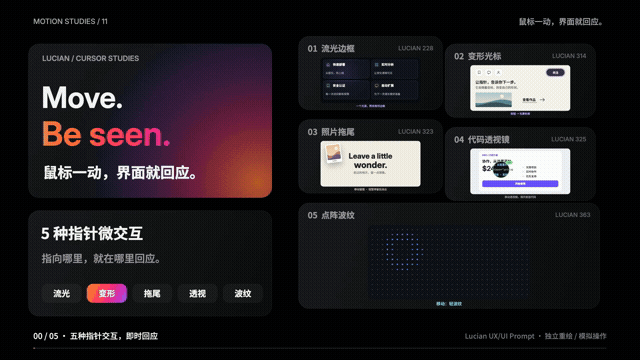

# Move. Be seen. · 鼠标一动，界面就回应

五种指针微交互，20 秒讲清 **适用场景 + AI 提示词 + 操作反馈**。

**[打开交互演示](https://jdb156158.github.io/vibe-MoveBeSeen/) · [观看完整视频](https://jdb156158.github.io/vibe-MoveBeSeen/#film) · [下载 MP4](media/cursor-microinteractions-20s.mp4) · [下载影片源码 ZIP](media/cursor-microinteractions-source.zip)**

## 视频展示

点击预览观看带配乐的 20 秒完整版。

[](https://jdb156158.github.io/vibe-MoveBeSeen/#film)

1920 × 1080 / 60fps / H.264 + AAC。原创合成配乐与音效，无口播。

## 五种真实交互

|控件|适用场景|网页操作|
|---|---|---|
|01 流光边框|功能卡片|移动照亮相邻边缘，点击选中，移出淡出|
|02 变形光标|品牌官网|指向按钮、文字、图片、链接变形，点图片查看作品|
|03 照片拖尾|创意作品集|移动按距离留图，点击扇形展开五张，随后自动退场|
|04 代码透视镜|组件教学|移动查看局部代码，点击展开全卡，再点收回|
|05 点阵波纹|科技首页|移动轻波、点击强波，多波叠加后衰减|

桌面支持指针与键盘；触屏通过点按触发对应反馈。页面提供重置、完整提示词复制和减少动态效果支持。示例价格与关注状态仅用于本地教学演示。

## 制作提示词

```text
用代码制作 20 秒、1920×1080、60fps 的知识短片。
主题：五种鼠标跟随与悬停反馈，来自 Lucian 228 / 314 / 323 / 325 / 363。
沿用黑色 Bento 网格、Inter 大标题、中文短句与橙粉紫标题渐变；控件内部保留原站对应配色。
五个控件片头、片尾同时展示并编号，中间每项放大操作，其他四项保留缩略卡。
每项包含场景、两行可复用 AI 提示词、清楚的动作和可见结果。
第一帧有主体和大字；顶部常驻“鼠标一动，界面就回应”。
0–2 总览，2–5 流光，5–8 变形，8–11 照片，11–14 透视，14–17 波纹，17–20 总结。
指针与效果的位置一致；透视镜是两层内容的遮罩；照片按时间出现和淡出；波纹按时间与距离传播。
不要用截图代替操作。用确定性的 Canvas draw(t)，本地加载字体和库，不使用时钟和无种子随机。
120 BPM，2/4 拍，首拍 0 秒；章节切换落在小节线上。Python 合成配乐与操作音，尾部完整解决并淡出。
先九帧检查、至少修改两轮，再用 Playwright 逐帧导出 JPG，FFmpeg 编码 H.264 yuv420p + AAC、faststart。
最后从实际 MP4 抽帧、验证完整播放和跳转，打包源码、提示词和制作步骤。
```

## 完整可复用 AI 提示词

### 01 流光边框
为产品首页制作四张功能卡片。用同一个鼠标坐标驱动径向光源，让光线跨过卡片缝隙并照亮相邻边缘，内部只轻微提亮；指针离开时平滑淡出。不要让光遮住文字，保持卡片可点击。触屏使用按下位置反馈，并支持减少动态效果。

### 02 变形光标
为品牌官网制作跟随指针的变形光标。悬停按钮时轮廓包裹按钮，悬停正文时缩为细线，悬停图片时变成带“查看”的圆，链接上显示箭头。形态与目标命中区域一致，切换平滑，离开页面恢复。自定义光标不拦截点击；触屏保留普通控件操作。

### 03 照片拖尾
为创意作品集制作照片拖尾。根据指针移动距离逐张生成照片，轻微旋转和弹入，停留后缩小淡出；点击时在点击位置扇形展开五张照片。限制同时存在的照片数量，保持内容可读。照片层不拦截页面操作，支持减少动态效果，触屏点击也可触发。

### 04 代码透视镜
为组件教学页制作代码透视镜。同一个卡片位置叠放 UI 与对应代码，用跟随鼠标的圆形遮罩显示代码层，圆边缘有细绿色描边。点击时从点击位置扩展到全卡，第二次点击收回；支持触屏点击、键盘切换和减少动态效果。UI 和代码必须对应，不移动底层内容。

### 05 点阵波纹
为科技产品首页制作交互点阵背景。指针移动时产生轻微同心波，点击时产生更强波纹，按距离与时间计算波前，点的尺寸与颜色随波传播，多个波纹可叠加后衰减。限制计算量与波纹数量，背景不遮挡正文。触屏点按可触发，减少动态模式保留静态或短暂反馈。


## 制作步骤

1. 核对 Lucian 228 / 314 / 323 / 325 / 363 的交互机制，编写场景、提示词与分镜。
2. 用确定性 Canvas `draw(t)` 制作黑色 Bento 影片，五张控件卡放大演示后回到总览。
3. 九帧预览检查并完成两轮修改；合成 120 BPM 配乐与操作音效。
4. Playwright 逐帧导出 1,200 张 JPG，FFmpeg 编码兼容 MP4。
5. 用 HTML / CSS / JavaScript 实现实际可操作的同款控件；影片与网页分别使用时间轴和真实输入。
6. 检查桌面、移动端、键盘和减少动态效果，上传 GitHub 并从 main 根目录发布 Pages。

详见 [制作指南](docs/MAKING.md)、[完整提示词](docs/PROMPTS.md)、[分镜与来源](film/treatment.md)、[验收记录](docs/QA.md)。

## 本地运行

```sh
python3 -m http.server 4858
# 浏览器打开 http://localhost:4858/
```

网页无需构建。重新渲染影片：

```sh
cd film
npm install
python3 make_audio.py
npm run stills
npm run render
sh encode.sh
```

需要 Node.js、Python 3 + numpy、Chrome 和 FFmpeg。非 macOS 请设置 `CHROME_PATH`，渲染细节见 [film/README.md](film/README.md)。

## 文件目录

- `index.html`、`site/`：响应式演示网页与五种真实交互。
- `film/`：确定性影片源码、音轨、字体、渲染和编码脚本。
- `media/`：MP4、动态预览、总览图、同款山景和影片源码 ZIP。
- `docs/`：可复用提示词、制作步骤、验收记录。

## 参考与许可

交互参考 [Lucian UX/UI Prompt](https://lucianlabs.dev/uxui-prompt/) 的 228、314、323、325、363；布局参考 [Design Style · Bento Grid](https://guanmo-ai.github.io/design-style/?lang=zh#work-01-bento-grid)。

中文文案、UI 演示、山景、动画与音轨独立编写，源站截图未剪入影片。字体和库的许可随 `film/` 保留。片尾总结：**场景 + 动作 + 反馈。让每个动作，都被回应。**
